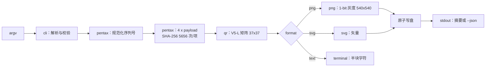

# 实现设计：Zig CLI

内容算法与图形参数见 [protocol.md](protocol.md)。本文只讨论工程实现。

## 1. 目标与非目标

目标：

- 单条命令把（机型, 序列号）映射为 4 张二维码文件，内容与验证向量逐字节一致。
- 纯本地、离线、零遥测；单文件静态可执行程序，无第三方依赖。
- 输出确定性：相同输入 → 逐字节相同的 PNG。
- 明确的行为契约：参数校验、退出码、文件名、覆盖策略。

非目标（v1 不做）：

- 固件解析、相机连接、真机扫码自动化。
- 网页/图形界面（参考项目已提供浏览器版）。
- ZIP 打包（已定不做，理由见 roadmap 决策记录 #3；分发用 `tar` 或目录复制）。
- K-3 III Monochrome 及其他机型（无已验证的机型值/功能 ID）。
- 批量序列号、模板定制、二维码美化（渐变、logo、圆角）。

## 2. 工具链

- Zig **0.17.0**（本机 `zig version` 已确认）。`build.zig.zon` 固定 `minimum_zig_version = "0.17.0"`。
- 只使用 `std`，`link_libc = false`，可交叉编译为 macOS / Linux(musl) / Windows 静态产物。
- 0.17 的 I/O 需要显式传入 `std.Io`：

  ```zig
  var threaded: std.Io.Threaded = .init(gpa);
  const io = threaded.io();
  std.Io.Dir.cwd().createFile(io, path, .{});
  std.Io.File.stdout().writer(io, &buffer);
  ```

  因此所有 I/O 只出现在 `main.zig` / `cli.zig`，核心模块保持纯函数，便于测试。

- 标准库能力对照：

  | 需求 | 采用 | 说明 |
  | --- | --- | --- |
  | SHA-256 | `std.crypto.hash.sha2.Sha256` | `init(.{})` / `update` / `finalResult` |
  | deflate（PNG IDAT） | `std.compress.flate.Compress` | `Container.zlib`，窗口缓冲 ≥ `flate.max_window_len`（65536 B） |
  | CRC32 / Adler32 | `std.hash.Crc32` / `std.hash.Adler32` | 手写 PNG 分块需要 |
  | 原子写 | `std.Io.Dir.createFileAtomic` | 先写临时文件再改名，避免半截文件 |

## 3. 数据流



四项功能共享同一个序列号哈希，可以只算一次；机型哈希与功能哈希也是常量，可以在一次运行内复用。

## 4. 目录与模块

```text
.
├── build.zig
├── build.zig.zon
├── src/
│   ├── main.zig       入口：装配 Io、调度、退出码
│   ├── cli.zig        argv 解析、usage、错误信息
│   ├── pentax.zig     机型/功能表、序列号规范化、payload 推导
│   ├── qr.zig         Version 5-L 编码器（码字、RS、图案、掩码）
│   ├── png.zig        1-bit 灰度 PNG 写出器
│   ├── svg.zig        SVG 写出器
│   └── terminal.zig   终端渲染
├── docs/
├── LICENSE
└── README.md
```

模块职责与公开接口（签名示意，实现细节留到编码阶段）：

```zig
// pentax.zig
pub const Model = enum { k1, k1ii, k3iii };
pub const Feature = struct { id: u32, name_zh: []const u8, slug: []const u8 };
pub const ModelInfo = struct { word: u32, prefix: []const u8, features: [4]Feature };
pub const Payload = [64]u8; // 小写 hex，无 NUL

pub fn modelInfo(model: Model) ModelInfo;
pub fn normalizeSerial(input: []const u8) error{InvalidSerial}![]const u8; // 返回去空白后的切片
pub fn payload(info: ModelInfo, feature: Feature, serial: []const u8) Payload;

// qr.zig
pub const Matrix = struct { size: u8 = 37, bits: [37][37]bool };
pub fn encode(payload: *const Payload) Matrix;
pub fn encodeWithMask(payload: *const Payload, mask: u3) Matrix; // 测试用

// png.zig
pub const Options = struct { scale: u8 = 12, border: u8 = 4 };
pub fn write(writer: *std.Io.Writer, matrix: *const Matrix, opts: Options) !void;

// svg.zig / terminal.zig
pub fn write(writer: *std.Io.Writer, matrix: *const Matrix, opts: png.Options) !void;
```

内存策略：矩阵 1369 字节、码字 134 字节、窗口缓冲 64 KiB，全部栈上或一次性分配，不用逐文件堆分配。

## 5. QR 编码器设计

只实现协议要求的单一组合，换取极小实现面与可穷举测试：

| 项目 | 值 |
| --- | --- |
| 版本 / 尺寸 | 5 / 37×37 |
| 纠错 / 块结构 | L / 1 块，106 数据码字 + 28 纠错码字 = 134 |
| 模式 | 字节模式（`0100`） |
| 对齐图案 | 版本 5 的中心集合 `{6, 30}`，去掉与定位图案重叠的位置后仅剩 `(30,30)` |
| 暗模块 | `(8, 4*5+9) = (8, 29)` |
| 版本信息 | 版本 ≥ 7 才需要，本实现不涉及 |
| 格式信息 | 5 位（纠错等级 L + 掩码），BCH(15,5)，异或 `0x5412` |

编码步骤：

1. 位流：`0100` + 8 位字符数（64）+ 64 字节 ASCII；放宽到 66 字节后加终止符、补零到字节边界，再用 `0xEC` / `0x11` 交替填充到 106 码字。
2. Reed-Solomon：GF(256)，本原多项式 `0x11D`；生成多项式 28 次，可在 `comptime` 生成，或启动时算一次。
3. 画功能图案：三个定位图案 + 分隔符、定时图案、对齐图案、暗模块、格式信息预留位。
4. 8 种掩码各生成一次，按 ISO/IEC 18004 惩罚规则（N1=3, N2=3, N3=40, N4=10）取最小值；该掩码用于写格式信息。
5. 数据填充：从右下角逐列（跳过第 6 列）之字形放置。

参考实现用 Nayuki 编码器自动选掩码；我们不要求掩码一致，只要求解码内容一致（protocol.md 第 4 节）。

## 6. PNG 写出

- 8 位头部 + `IHDR`（宽高 540×540、bit depth 1、color type 0 灰度、无交错）+ `IDAT` + `IEND`。
- 每个扫描行：1 字节过滤类型 `0`，随后 `ceil(width/8)` 字节，MSB 在前；540 px → 68 字节 + 1 字节 = 69 字节/行。
- `IDAT` 用 zlib 容器（`std.compress.flate.Compress`），`Crc32` 校验各分块。
- 选 1-bit 灰度而非 8-bit RGBA：体积约为 1/32，无色彩管理问题，扫码器只关心黑白对比。
- `--scale` 与 `--border` 可调，默认 12 / 4，与参考实现 540×540 完全一致；改变只影响缩放，不影响可解码性。
- 确定性：PNG 不写时间戳/文本分块，zlib 头固定，deflate 实现固定 → 同输入同字节。

体积实测：540×540 位图原始约 36.8 KB（含过滤字节），zlib 后单张 688–729 B。

## 7. 终端输出（`text`）

用途：不落盘、直接用手机扫屏幕；也作为矩阵正常与否的肉眼核对手段。与 PNG 共用同一份矩阵，不存在第二条编码路径。

- **几何**：内容区 37 模块 + 白边 4×2 = 45 模块。半块渲染下，一个字符格 = 1 模块宽 × 2 模块高，因此输出 **45 列 × 23 行**。常见终端字符宽高比约 1:2，模块看起来接近正方形。
- **字符与颜色**：用 `▀`（U+2580，上块）承载上下两个模块，前景色 = 上模块，背景色 = 下模块；颜色用显式 SGR：`38;5;0`/`48;5;0` 黑、`38;5;15`/`48;5;15` 白。固定**白底黑模块**，不依赖终端主题，也不输出反色码（iOS 相机不保证识别反色二维码）。最后一行落单时用 `▄`（下块）补齐。
- **TTY 与降级**：`std.Io.File.isTty(io)` 判断 stdout。非 TTY（重定向、管道、CI）自动改用无色模式：每模块 2 个 ASCII 字符（`██` 黑 / `  ` 白），此时才允许 `--invert` 适配浅色终端。`NO_COLOR` / `CLICOLOR_FORCE` 优先于自动检测；显式 `--color=always|never` 最高。
- **排版**：行尾不留多余空格，不做清屏或光标定位，只顺序输出，保证可重定向、可复制。多张时纵向堆叠：每张前一行标题（`K-1 II 渐变 ND · 序列号 0012345`），后留一个空行；4 张约 100 行——只要一两张时用 `--feature`。
- **参数交互**：`--border` 生效；`--scale` 对 text 无意义（固定每模块 1 字符宽）。text 不写文件，因此 `--out`、`--force` 被忽略；与 `--json` 互斥，同时给出按用法错误退出。
- **已知限制**：终端字体抗锯齿、个别终端半块字符有 1 px 缝隙、屏幕亮度与反光。手机扫不出时先截图转 PNG 或用 `-f png` 对照，不要先怀疑矩阵。
- **验证方式**：解析 `-f text` 的 ANSI 输出还原成 45×45 模块网格、栅格化为图片后交给 zxing-cpp，彩色与无色两种模式都能解出预期 payload。

## 8. CLI 契约

单一命令，无子命令。

```text
pk-qr --serial <digits> [--model k1ii] [--out DIR] [--format png] [--json]
```

| 参数 | 取值 | 默认 | 说明 |
| --- | --- | --- | --- |
| `-s, --serial` | 字符串 | 必需 | 1–20 位 ASCII 数字，首尾空白被去除 |
| `-m, --model` | `k1`/`k1ii`/`k3iii` | `k1ii` | 未知值直接报错，不回退 |
| `-o, --out` | 目录 | `.` | 不存在则报错，不自动创建 |
| `-f, --format` | `png`/`svg`/`text` | `png` | `text` 直接打印到 stdout，不落盘（见第 7 节） |
| `--color` | `auto`/`always`/`never` | `auto` | 仅 text；`auto` = stdout 是 TTY 且未设 `NO_COLOR` |
| `--invert` | 开关 | 关 | 仅 text 无色模式，适配浅色终端 |
| `--scale` | 1–64 | 12 | 仅 png/svg |
| `--border` | 0–16 | 4 | 静区模块数 |
| `--feature` | ID 或 slug，可重复 | 全部 4 项 | 只生成指定功能 |
| `--json` | 开关 | 关 | stdout 输出结构化结果，人类提示转 stderr |
| `--force` | 开关 | 关 | 允许覆盖已存在文件 |
| `--dry-run` | 开关 | 关 | 只计算与打印，不写文件 |
| `-h, --help` / `-V, --version` | 开关 | — | 立即退出 0 |

文件名（ASCII，避免 CJK 文件名在 Windows/脚本里的问题）：

```text
{prefix}_{序号2位}_{slug}_{serial}.{ext}
K1II_01_gradient-nd_0012345.png
K1_03_remote-focus-step_1234567.png
```

示例：

```sh
# 默认 K-1 II，四项功能，写当前目录
pk-qr --serial 1234567

# K-3 III，只生成渐变 ND 与星空影像处理，指定输出目录与缩放
pk-qr -m k3iii -s 0012345 -o out --feature gradient-nd --feature astro-processing --scale 16

# 管道检查：不落盘，只打印 payload
pk-qr -s 1234567 --dry-run --json

# 直接在终端看一张，用手机扫屏幕（不写任何文件）
pk-qr -s 0012345 --feature gradient-nd -f text

# 重定向时自动降级为无色块字符
pk-qr -s 1234567 -f text > qr.txt
```

`--json` 结构：

```json
{
  "ok": true,
  "model": "k1ii",
  "modelWord": 78400,
  "serial": "0012345",
  "format": "png",
  "dryRun": false,
  "written": 4,
  "codes": [
    { "id": 2, "name": "渐变 ND", "slug": "gradient-nd",
      "payload": "9ca3…829d", "path": "out/K1II_01_gradient-nd_0012345.png" }
  ]
}
```

实现细节：`--out` 为默认 `.` 时 `path` 不带 `./` 前缀；`--dry-run` 时 `written` 为 0、`dryRun` 为 true。失败时不输出 JSON，只向 stderr 打印中文提示并以非 0 退出（避免读者误解析半截 JSON）。

退出码：

| 码 | 含义 |
| --- | --- |
| 0 | 成功 |
| 2 | 参数用法错误（未知参数、缺 `--serial`、取值越界） |
| 3 | 输入非法（序列号、机型、功能选择） |
| 4 | I/O 失败（目录不存在、写盘失败） |
| 5 | 目标文件已存在且未加 `--force` |

行为约定：

- 先全部渲染到内存，再统一写盘；任何一项渲染失败则一个文件都不写。
- 覆盖检测在写盘前完成，避免写了一半才发现冲突。
- 写盘用 `createFileAtomic`，失败不留半截文件。
- stdout 只放数据（表格摘要、`--json` 或 text 二维码），人类提示与警告走 stderr。
- `-f text` 跳过整个写盘阶段：`--out`、`--force` 被忽略（不报错），`--json` 同时使用按用法错误处理。

## 9. 错误处理

- 用户输入错误用 `error.InvalidSerial` / `error.UnknownModel` / `error.UnknownFeature` 等具名错误，`main` 统一映射为退出码与提示，不 panic。
- 内部不变量（矩阵尺寸、码字计数、格式信息长度）用 `assert`，`ReleaseSafe` 下保留，用于捕获实现错误。
- 不做静默降级：不认识的机型/功能 ID 一律报错，绝不猜测。

## 10. 许可与合规

- 本项目：**GPL-3.0-or-later**（维护者已确认）。每源文件首行 SPDX：`// SPDX-License-Identifier: GPL-3.0-or-later`；根目录 `LICENSE` 为 GPLv3 全文。「or later」授权来自 README 与 SPDX 头，GPLv3 正文本身只提供条款模板。
- 不复制参考项目代码。`docs/k1ii-qr/` 只是本地对照材料，被 `.gitignore` 排除，不进版本库、不进发行物；参考项目本身也没有 LICENSE 文件，其 README 声明的第三方组件（Nayuki 编码器 MIT、fflate MIT）与本项目无关。
- 若后续引入第三方代码，必须保留其许可并在 `THIRD-PARTY-NOTICES.md` 列明。当前设计目标是零第三方代码。
- 本仓库提交的只有算法描述与合成序列号的验证向量，不含真实序列号、固件或照片。

## 11. 风险与取舍

| 风险 | 影响 | 对策 |
| --- | --- | --- |
| 自研 QR 编码器出错 | 相机扫不出 | 固定 V5-L 单一组合；结构断言 + 自解码；已用 zxing-cpp 解码生成的 PNG 与终端渲染（4/4 一致） |
| Zig 0.17 `std.Io` 仍在演进 | 升级成本 | 核心纯函数不接触 I/O；I/O 集中在 main/cli |
| 掩码与参考实现不同 | 视觉差异 | 不追求逐字节相同，只保证解码内容与向量一致 |
| 文件名中文不兼容 | Windows/脚本出错 | 文件名用 ASCII slug，中文只出现在 JSON/终端 |
| 真机未验证 | 可能被相机拒绝 | 保持参考实现的图形参数；`--scale`/`--border` 可回调；在 roadmap 里列为待验证项 |
| 用户输入路径字符 | 目录穿越 | 序列号只允许 `0-9`，文件名其余部分由代码生成 |

## 12. 构建与发布

```sh
zig build                        # 生成 zig-out/bin/pk-qr
zig build test                   # 单元测试
zig build run -- --serial 1234567
zig build -Doptimize=ReleaseSafe # 发布构建
```

- `build.zig` 按 0.17 模板形态：`b.addExecutable(.{ .name = "pk-qr", .root_module = b.createModule(.{ .root_source_file = b.path("src/main.zig"), .target = target, .optimize = optimize }) })`。
- 交叉编译：`-Dtarget=aarch64-macos`、`x86_64-linux-musl`、`aarch64-linux-musl`、`x86_64-windows`（后三者已实测产出可执行文件）。
- 版本号沿用 `build.zig.zon` 的语义化版本，`--version` 输出 `pk-qr <version>`。
- 参考体积：`ReleaseSafe` 单文件约 588 KB（macOS arm64），无运行时依赖。
